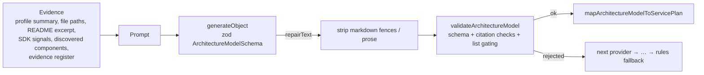

# AI Integration

## What the AI is allowed to do

The AI produces one thing: an **ArchitectureModel**, a structured description of the *application* (components, technologies, relationships), with every component citing evidence. It never chooses AWS services, prices, diagram XML or CloudFormation. `architecture.ts` turns the model into services deterministically.



## Provider architecture (`src/lib/llmClient.ts`)

| Order | Env key | Model | Package |
|---|---|---|---|
| 1 | `GOOGLE_API_KEY` or `GOOGLE_GENERATIVE_AI_API_KEY` | `GOOGLE_MODEL`, default `gemini-3.8-flash` (**default not verified in the audit, so set it explicitly**) | `@ai-sdk/google` |
| 2 | `OPENROUTER_API_KEY` | `OPENROUTER_MODELS` (comma list), default three free models | `@openrouter/ai-sdk-provider` |

- Providers are tried **in order (failover)**. Blank keys count as "not set".
- Each attempt has a 60 s timeout, `maxRetries: 3`, `temperature: 0`, and is also cancelled by the 90 s whole-request deadline.
- DeepSeek and Groq are **not implemented** (no packages installed). Older docs listed them.
- Provider code is isolated in `llmClient.ts`; the rule engine has no provider dependency.

## Prompts and structured output

- **System prompt** (`buildSystemPrompt`): the evidence rule ("every component cites real evidence"), "minimal architectures are correct", the closed component-type vocabulary generated from `COMPONENT_TYPES`, and "you are NOT choosing AWS services".
- **Repository prompt** (`buildArchitecturePrompt`): the analyzer summary, file paths only (no raw file dumps), README excerpt, SDK signals, discovered components ("a floor, not a template"), and the evidence register (`ev-1…`) the model must cite.
- **Description prompt**: decompose only what is stated, cite the phrase each component came from.
- Output is generated with `generateObject` against `ArchitectureModelSchema` (zod).

## Validation (what makes an answer usable)

1. **Framing repair**: `extractJsonObject` strips ```json fences or surrounding prose. It changes framing only; the result is still schema-checked.
2. **Schema**: `ArchitectureModelSchema.safeParse`. Unknown component types or a missing `components` array cause rejection (reason `schema`).
3. **Citations**:
   - Repository: each evidence entry must match a register record by id, path, technology or detail, **and** that record must support the claimed technology (`isEvidenceSupportingComponent`). For example, citing `pom.xml` with only Spring Web cannot justify "Lambda".
   - Description: a quoted phrase must appear in the description, or the component's technology must be named there.
   - Components without valid evidence are dropped. If none remain, the answer is rejected (reason `no-evidence`).
4. **List gating**: `languages`, `frameworks`, `databases`, `dependencies` and `buildConfig` entries must be corroborated by the register (or description). They feed `mapListTechnologies`, which can add services.
5. **Relationships** referencing dropped components are removed.

## Fallback behaviour (always observable)

| Situation | `engine` | Diagnostics (stable `code`) |
|---|---|---|
| No key configured | `rules` | `llm-not-configured` (info) |
| Provider throws (network, 401, 429, timeout) | tries next; if all fail → `rules-fallback` | `llm-call-failed` per attempt, `llm-all-providers-failed`, `llm-fallback-to-rules` |
| Provider answers but answer is invalid/uncited | tries next; if none succeed → `rules-fallback` | `llm-model-schema` / `llm-model-no-evidence`, `llm-fallback-to-rules` |
| Request deadline hit | stops trying | `llm-call-failed` |

The UI shows `engine` as a banner (AI-enhanced / Rules-only / AI failed — rules baseline used) with an expandable diagnostics list. The API returns `engine` and `diagnostics` in every response.

## Failure handling and secrets

- Error messages are passed through `redactSecrets` before logging or returning diagnostics. It removes `?key=` parameters, `Authorization`/`x-goog-api-key` values, and token-shaped strings (`AIza…`, `sk-…`, `gsk_…`, `ghp_…`).
- The route never returns raw exceptions. Uncaught errors become a generic 500 and are logged on the server only.
- No unnecessary AI calls: repositories with insufficient signal stop before inference, and the AI is called at most once per provider attempt.

## Testing without paid calls

`analyzeArchitecture(opts, { providers })` and `runInference({ …, llmProviders })` accept injected providers. Tests use the AI SDK's `MockLanguageModelV4` (`ai/test`) to simulate:

- fenced JSON → repaired and used (`engine: "llm"`)
- a provider that throws 429 with a key in the message → `rules-fallback`, key redacted
- prose instead of JSON, or a schema violation → rejected
- hallucinated list entries or citations → dropped

See `src/lib/__tests__/auditFixes.test.ts` (BUG-11, BUG-12).

## Known gaps

- The default Gemini model id and the OpenRouter free-model ids could not be verified offline. Configure them explicitly.
- Prompts are long for big monorepos; there is no token budgeting beyond the 60-file / 64 KB caps.
- `test:baseline` (merged column) needs a real key and network, so it was not run in the audit.
