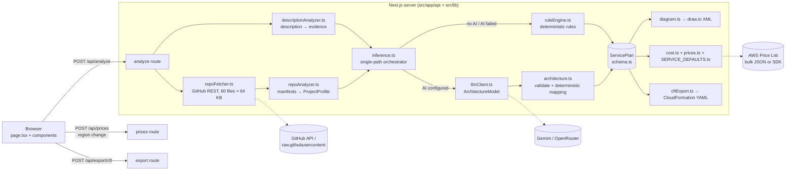
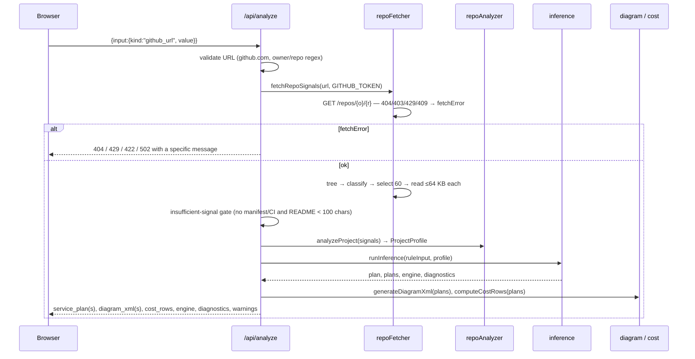
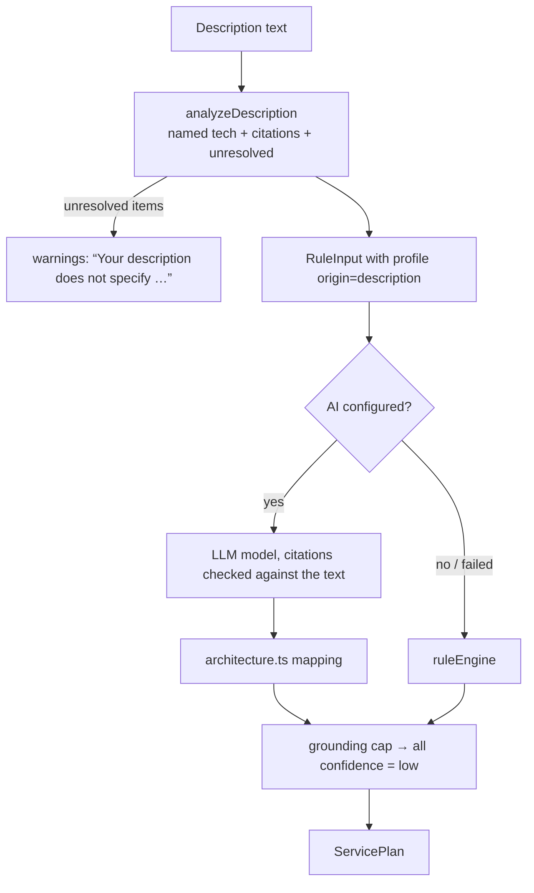

# System Architecture

## High-level view

One Next.js 16 app serves both the UI and three API routes. All analysis runs on the server, so API keys, the GitHub token and price lookups never reach the browser.



## Component responsibilities

| Component | File(s) | Responsibility | Never does |
|---|---|---|---|
| Analyze API | `src/app/api/analyze/route.ts` | Validates input, runs the pipeline, assembles the response (`engine`, `diagnostics`, `warnings`) | Return raw error messages to the browser |
| Repo fetcher | `src/lib/repoFetcher.ts` | Validates owner/repo, reads metadata + tree, picks key files, reads ≤ 64 KB each, classifies failures | Clone, run repo code, follow redirects |
| Repo analyzer | `src/lib/repoAnalyzer.ts` | Parses manifests (npm, pip, Maven, Gradle, Go, Cargo, …), compose/serverless/Terraform, builds the evidence register | Call the network or an LLM |
| Description analyzer | `src/lib/descriptionAnalyzer.ts` | Turns prose into a profile of *named* technologies with quoted citations; lists open questions | Guess technologies that weren't named |
| Inference orchestrator | `src/lib/inference.ts` | Picks exactly one path (AI → mapping, or rules), applies the grounding cap, attaches the alternate proposal | Merge AI and rules output |
| LLM client | `src/lib/llmClient.ts` | Builds the prompt, calls providers with failover, repairs fenced JSON, validates, redacts secrets | Choose AWS services |
| Architecture mapper | `src/lib/architecture.ts` | Verifies citations, gates list technologies, maps components → AWS services deterministically | Accept uncited components |
| Rule engine | `src/lib/ruleEngine.ts` | Evidence → services with explicit rules, compute exclusivity, negative ("do not infer") rules, role-based relationships | — |
| Contract | `src/lib/schema.ts` | `ServicePlanSchema` (155-service allowlist), diagnostics schema | — |
| Diagram | `src/lib/diagram.ts` | Tiered layout, edges, XML escaping | Add services not in the plan |
| Cost | `src/lib/cost.ts`, `prices.ts`, `SERVICE_DEFAULTS.ts` | Billing lines, price lookup + fallback, free tiers, rescaling | Present a missing price as $0 |
| CFN export | `src/lib/cftExport.ts` | Resources per service, VPC prerequisite, generated secrets, validator | Deploy anything, embed secrets |

## Request flow: GitHub URL



## Request flow: description



## The single contract: `ServicePlan`

```text
ServicePlan
├─ inputKind            github_url | description
├─ components[]         id, type, technology, evidence[], confidence, status
├─ relationships[]      from, to, type, evidence ("inferred: …" ⇒ dashed edge)
├─ deploymentModel[]    per component: public, needsVpc, needsMultiAz, …
├─ awsMappings[]        componentId, serviceId (allowlisted), confidence, evidence, category
├─ detectedPattern      UI label only (8 values)
├─ terminalState        OK | INSUFFICIENT_SIGNAL | LIBRARY_REPO | IAC_ONLY | MONOREPO_OK
├─ metadata             grounding, truncated, parseErrors, dbEngine
└─ proposals[]          primary + optional curated alternate
```

Everything downstream reads only this object, which is why the diagram, the cost and the template stay consistent.

## Execution modes (observable)

| `engine` | Meaning | UI banner |
|---|---|---|
| `llm` | AI described the app; rules mapped it | “Mode: AI-enhanced” |
| `rules` | No provider configured | “Mode: Rules-only” |
| `rules-fallback` | A provider was configured but failed or answered unusably | “Mode: AI failed — rules baseline used” + diagnostics |

## Trust boundaries

- **Repository contents are untrusted.** They are size-capped, parsed (never executed), and sent to the LLM only as summarised evidence.
- **LLM output is untrusted.** It is schema-validated, its citations are checked, uncorroborated list entries are dropped, and it can never emit services, prices, XML or YAML directly.
- **Browser input is untrusted.** Each route validates body shape, lengths, region, user count, environment and app name.
